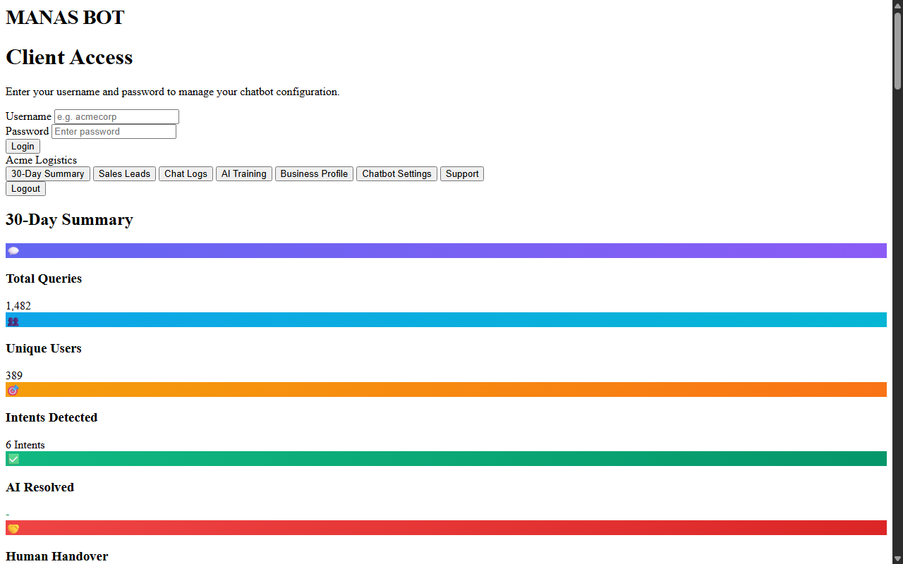
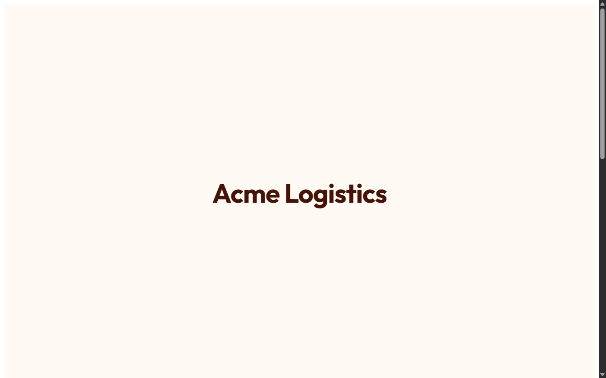
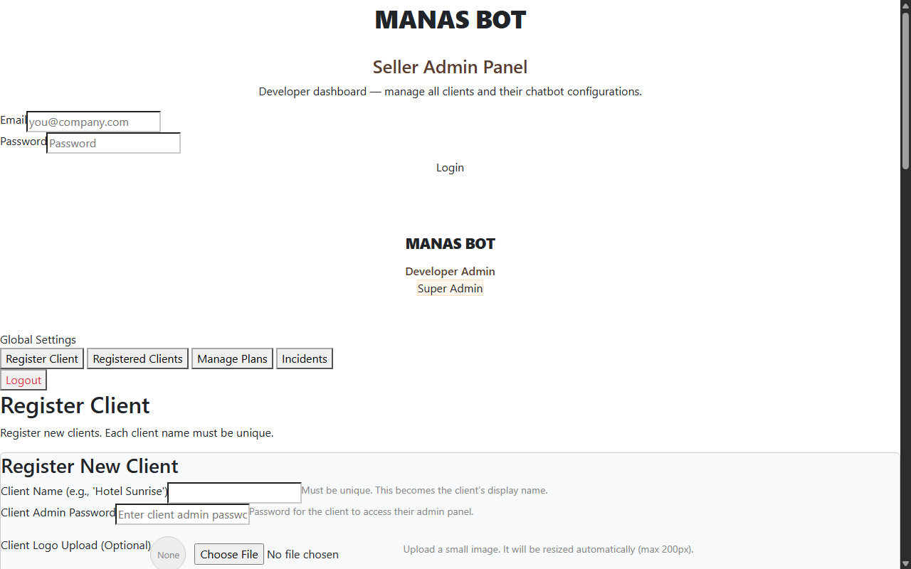

# MANASBOT

> An AI-powered, multi-tenant business knowledge assistant that allows businesses to upload their proprietary documents and provide intelligent, context-aware answers through an embeddable customer chatbot.

---

## 1. What is ManasBot?

**ManasBot** is a production-oriented B2B AI SaaS platform that transforms unstructured business documentation into an interactive, multilingual customer support assistant. Each business tenant receives an isolated workspace to manage knowledge documents, review customer inquiries, capture qualified sales leads, and embed a branded AI chat widget onto their website with a single script tag.

Powered by a decoupled asynchronous backend, local multilingual ONNX embedding models, and PostgreSQL vector similarity search, ManasBot provides sub-second, factually grounded answers backed by source citations without hallucination.

---

## 2. Key Features

- **Advanced RAG & Semantic Search**: End-to-end vector retrieval engine with hierarchical text chunking (600 chars, 100 overlap) and PostgreSQL `pgvector` HNSW cosine similarity search.
- **Local Multilingual Embedding Engine**: Runs `intfloat/multilingual-e5-small` (384 dimensions) locally on CPU via FastEmbed ONNX runtime with zero external API costs or embedding latency.
- **Source Attribution & Citations**: Chatbot answers are factually grounded and accompanied by source document badges displaying relevance confidence scores (`📄 filename.pdf (94%)`).
- **Multi-Tenant Architecture**: Strict row-level tenant data isolation (`tenant_id`) ensuring zero cross-tenant leakage across vector embeddings, chat history, and customer leads.
- **Multi-Format Document Ingestion**: Ingests PDF, DOCX, XLSX/XLS, CSV, TXT, and live website URLs with automated periodic re-scraping every 6 hours.
- **Dual Administration Portals**:
  - **Super Admin Portal**: Manage global tenants, billing subscription plans, team members, and system incidents.
  - **Client Admin Portal**: Monitor real-time conversation analytics, manage Knowledge Base documents and FAQs, configure business identity, and review captured leads.
- **Embeddable Chatbot Widget**: Lightweight, responsive floating chat widget customizable per tenant (colors, avatar, greeting) embeddable via a single `<script>` snippet.
- **Automated Lead Capture & Notifications**: Automatically detects contact details in conversation turns and triggers instant email alerts.
- **Decoupled Non-Blocking Architecture**: High-performance request lifecycle (Phase A Read → Phase B Vector Search & Groq LLM → Phase C Write) holding zero database connections during inference.

---

## 3. Screenshots

### Client Admin Dashboard & Analytics

### Knowledge Base & Indexed Chunk Management

### Embeddable Chatbot Interface

### Factual Grounding & Source Citations

### Super Admin Management Portal

---

## 4. Tech Stack

| Layer | Technologies |
| :--- | :--- |
| **Backend & APIs** | Python 3.11+, FastAPI, Uvicorn, Pydantic v2, Starlette |
| **AI & LLM Orchestration** | Groq API (Llama 3.1 8B Instant, Llama 3.3 70B Versatile, Gemma 2 9B), LangChain |
| **Vector Engine & RAG** | FastEmbed (Rust ONNX Runtime CPU), `multilingual-e5-small` (384-d), `langchain-text-splitters` |
| **Database & ORM** | PostgreSQL (Neon Serverless), `pgvector` (HNSW indexing), SQLAlchemy, Alembic |
| **Document Processing** | PyPDF2 / pypdf, python-docx, openpyxl, pandas, BeautifulSoup4, HTTPX (async scraping) |
| **Security & Auth** | PyJWT (RBAC: `super_admin`, `admin`, `support`, `viewer`), Fernet AES-128 encryption, Passlib (bcrypt) |
| **Frontend & UI** | Vanilla ES6+ JavaScript, HTML5, Modern CSS3, Chart.js, Marked.js |
