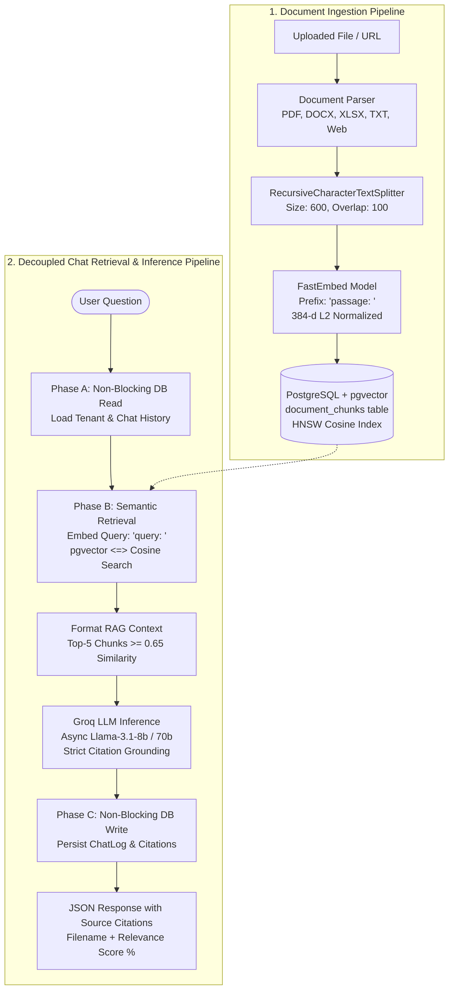

# ManasBot — Phase 2: Advanced RAG Architecture

**Project:** ManasBot (B2B AI Chatbot SaaS)
**Author:** DeepMind Agent / Rahul Kumar
**Version:** 2.0.0 (Phase 2 Architecture)

---

## 1. System Overview

ManasBot is a multi-tenant B2B AI SaaS platform that allows enterprises to train customized customer support chatbots on their proprietary knowledge base documents (PDF, DOCX, TXT, CSV, Excel, and website URLs).

In Phase 2, ManasBot replaces basic full-document truncation with an advanced Retrieval-Augmented Generation (RAG) system powered by:
- **FastEmbed ONNX Runtime** (`intfloat/multilingual-e5-small`) running locally on CPU.
- **PostgreSQL `pgvector`** with HNSW (Hierarchical Navigable Small World) indexing.
- **Hierarchical Recursive Text Chunking** with metadata tracking.
- **Decoupled Asynchronous Lifecycle** preventing database connection starvation.



---

## 2. Core Architectural Components

### 2.1 Embedding Model Specification

| Parameter | Specification |
| :--- | :--- |
| **Model Name** | `intfloat/multilingual-e5-small` |
| **Framework** | FastEmbed (Rust ONNX Runtime CPU inference) |
| **Vector Dimensions** | 384 dimensions |
| **L2 Normalization** | Enabled (`norm = 1.0`) |
| **Asymmetric Query Prefix** | `query: ` |
| **Asymmetric Document Prefix** | `passage: ` |
| **Languages Supported** | 100+ languages (English, Hindi, Spanish, French, German, Chinese, Arabic, etc.) |
| **Memory Footprint** | ~180MB RAM; zero GPU requirements |
| **Execution Pattern** | Singleton pattern via `get_embedding_model()`, threadpool offloaded |

#### Why `multilingual-e5-small`?
1. **Lightweight & Fast:** 384-dimensional dense vectors offer sub-15ms embedding times per chunk on modern CPUs.
2. **True Multilingual Cross-Lingual Alignment:** Queries in Hindi ("वापसी नीति") achieve high semantic cosine similarity with English documents ("Return Policy"), enabling seamless cross-lingual support.
3. **Optimized Asymmetric Search:** Distinct `query: ` and `passage: ` prefixes train the encoder to map brief questions into the same latent semantic space as descriptive documentation paragraphs.

---

### 2.2 Intelligent Document Chunking Strategy

Chunking is handled by `backend/rag/chunker.py` using `langchain_text_splitters.RecursiveCharacterTextSplitter`.

```
Document Text
  │
  ├─► Split by "\n\n" (Paragraphs)
  │     └─► Exceeds 600 chars?
  │           ├─► Split by "\n" (Lines)
  │           │     └─► Exceeds 600 chars?
  │           │           ├─► Split by " " (Words)
  │           │           │     └─► Fallback: Character split
  │           │           └─► Fits within 600 chars ──► Emit Chunk
  │           └─► Fits within 600 chars ──► Emit Chunk
  └─► Overlap: 100 chars between adjacent chunks to preserve contextual continuity
```

**Metadata Preserved Per Chunk:**
- `document_id`: Parent document UUID.
- `tenant_id`: Mandatory tenant UUID.
- `chunk_index`: 0-indexed sequence ordering.
- `filename`: Human-readable file name or source URL.
- `token_count`: Estimated token count for LLM context budgeting.

---

### 2.3 Vector Database & Indexing Architecture

#### Database Schema: `document_chunks`

```sql
CREATE TABLE document_chunks (
    id VARCHAR PRIMARY KEY,
    document_id VARCHAR NOT NULL REFERENCES knowledge_documents(id) ON DELETE CASCADE,
    tenant_id VARCHAR NOT NULL,
    chunk_index INTEGER NOT NULL,
    chunk_text TEXT NOT NULL,
    token_count INTEGER NOT NULL DEFAULT 0,
    embedding VECTOR(384) NOT NULL,
    is_active BOOLEAN NOT NULL DEFAULT TRUE,
    created_at TIMESTAMP WITH TIME ZONE DEFAULT NOW()
);

-- Relational Filtering Index
CREATE INDEX ix_document_chunks_tenant_id_is_active
ON document_chunks (tenant_id, is_active);

-- Parent Document Lookup Index
CREATE INDEX ix_document_chunks_document_id
ON document_chunks (document_id);

-- HNSW Vector Cosine Distance Index
CREATE INDEX ix_document_chunks_embedding_hnsw
ON document_chunks USING hnsw (embedding vector_cosine_ops)
WITH (m = 16, ef_construction = 64);
```

#### HNSW Vector Search Mechanics
- **Distance Operator:** `<=>` (Cosine Distance in pgvector).
- **Cosine Similarity Equation:**
  $$\text{Cosine Similarity} = 1 - (\text{embedding} \Leftrightarrow \text{query\_vector})$$
- **Filtering Logic:**
  1. Primary relational constraint: `tenant_id = :tenant_id AND is_active = TRUE`.
  2. Joined with `knowledge_documents.is_active = TRUE`.
  3. Ordered by cosine distance ascending.
  4. Capped at `LIMIT :top_k` (default: 5).
  5. Post-retrieval threshold filter: `similarity_score >= 0.65`.

---

### 2.4 Decoupled Non-Blocking Request Lifecycle

Preserving Phase 1 performance standards, the `/chat` endpoint operates in three distinct phases:

```
[Incoming POST /chat Request]
       │
       ▼
┌─────────────────────────────────────────────────────────────┐
│ PHASE A: FAST NON-BLOCKING DATABASE READ                     │
│ 1. Checkout session from central connection pool.           │
│ 2. Fetch tenant profile, subscription status, and quotas.   │
│ 3. Fetch recent conversation history (last 5 turns).        │
│ 4. CLOSE DATABASE SESSION & RETURN CONNECTION TO POOL.      │
└─────────────────────────────────────────────────────────────┘
       │
       ▼ (ZERO DB CONNECTIONS HELD)
┌─────────────────────────────────────────────────────────────┐
│ PHASE B: ASYNC RAG RETRIEVAL & LLM INFERENCE                │
│ 1. Generate query embedding (threadpool offloaded).         │
│ 2. Execute pgvector cosine retrieval (short-lived query).   │
│ 3. Construct structured RAG context block with citations.   │
│ 4. Await Groq async LLM completion (Llama-3.1 / 70b).       │
│    -> If primary model rate limits, fall back instantly.    │
└─────────────────────────────────────────────────────────────┘
       │
       ▼ (ZERO DB CONNECTIONS HELD)
┌─────────────────────────────────────────────────────────────┐
│ PHASE C: FAST NON-BLOCKING DATABASE WRITE                    │
│ 1. Checkout short-lived database session.                   │
│ 2. Encrypt question & answer using Fernet AES-128-CBC.      │
│ 3. Commit ChatLog record and increment usage metrics.       │
│ 4. CLOSE DATABASE SESSION & RETURN CONNECTION TO POOL.      │
└─────────────────────────────────────────────────────────────┘
       │
       ▼
[Return HTTP 200 ChatResponse with Sources]
```

---

### 2.5 Multi-Tenant Row-Level Security

Multi-tenancy is enforced at the database query level:
- Every query to `document_chunks` explicitly includes `WHERE tenant_id = :tenant_id`.
- The `tenant_id` is resolved from verified authentication tokens or validated tenant credentials.
- Unit test `test_18_multi_tenant_isolation_security` guarantees that even if Tenant B queries for the exact unique secret phrases present in Tenant A's documents, 0 chunks are returned to Tenant B.

---

### 2.6 Source Attribution & Citation Protocol

When relevant knowledge base chunks are retrieved:
1. Chunks are formatted into the prompt:
   ```
   ### VERIFIED KNOWLEDGE BASE CONTEXT (Top Relevant Excerpts):
   --- [Source 1: Return_Policy.pdf | Relevance: 94%] ---
   Customers may return items within 30 days of purchase for a full refund...
   ```
2. System instructions enforce citation format:
   ```
   When providing answers based on the 'VERIFIED KNOWLEDGE BASE CONTEXT',
   cite the source file name in brackets (for example: '[Source: Return_Policy.pdf]').
   Do not fabricate document names or citations.
   ```
3. The API response returns structured metadata:
   ```json
   {
     "answer": "You can return items within 30 days of purchase [Source: Return_Policy.pdf].",
     "sources": [
       {
         "document_id": "doc_e2e_shipping",
         "filename": "Return_Policy.pdf",
         "relevance_score": 0.94
       }
     ]
   }
   ```
4. Chatbot UI parses `data.sources` and renders interactive source badges under the bot response bubble.
